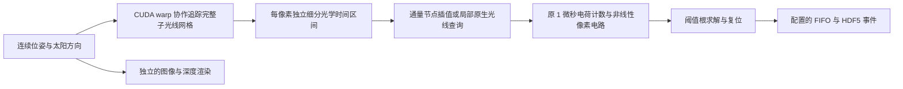

# 事件渲染性能优化与数值验证

相机继续使用 `config/davis346.yaml` 和 `config/prophesee.yaml`。未缩放分辨率、内参或 16×16 子光线网格，也未改变阈值、原轨迹速度、原 10 µs 位姿区间和原 1 µs 电路积分步长。原生逐电路单元追踪模式保留为对照。

## 原来的计算瓶颈

原实现已经按像素使用 CUDA 并行，但每个像素线程在每个电路单元里串行追踪 256 条子光线，计算 BVH 相交、太阳遮挡、Hapke 散射，再积分像素电路。DAVIS 一段 60 s 序列对应约 5.40×10¹² 个电路单元和 1.38×10¹⁵ 条主光线；Prophesee 对应约 1.84×10¹³ 个单元和 4.72×10¹⁵ 条主光线，尚未计入阴影光线。

原融合核每线程有 1536 B 本地存储，包含事件数组和 BVH 栈。128 线程块在 RTX 4090 上的静态驻留上限为每 SM 三块，相对于 1536 线程上限为 25%；这不是 Nsight 实测占用率。分阶段 CUDA 计时显示光学追踪主导了开销。将架构从 sm_52 改为 sm_89 没有单独带来明显的稳态加速。

Southpole 使用完整 18194×18194 DEM，生成 331,021,636 个顶点和 661,970,498 个三角形；完整 BVH 构建本身约需 9 分钟。这里没有裁剪或简化原地形。

## 新的计算路径



一个 warp 协作计算一个像素的 256 条子光线，按原采样顺序累加。图像/深度核与原串行完整网格对照：深度相同，辐亮度仅有浮点累加舍入差异，平面测试最大绝对差约 4.3×10⁻¹⁴。图像端不使用空间自适应降采样。

事件端每个最多约 2 ms 的区间先直接追踪 0、1/4、1/2、3/4、1 五个时刻。每个像素单独细分，需要时继续追踪内部节点。已经追踪的中点也保留为通量节点，而非只用于检查后丢弃。节点对应真实几何、遮挡和 Hapke 查询，不来自常规图像帧。

细分同时检查中点光电流和该电流对非线性受光器电压的影响。默认瞬时对数电流检查尺度为 0.01；叶区间预计不超过一个电子时，以电压检查为主。叶区间预测电压差要求低于该像素 ON/OFF 最小阈值的 0.001 倍。该检查使用当前电压和原配置的有效电荷尺度，是工程数值判据，**不是对任意遮挡变化的全局误差证明**。

不收敛的微小时间片在原电路单元中点直接追踪；不会因为一个阴影跳变重算整幅图或整个像素的完整区间。缓存溢出的像素才回退到整个区间的原生采样。缓存容量按 GPU 空闲内存选择 128/256/512，实际容量写入数据集；它不改变相机参数和空间采样。没有局部原生查询时不分配其大缓存。

光学处理完成后，仍在每个原位姿区间的原电路单元里生成 `Poisson(rate × Δt)` 电子数，以 `qN/Δt` 输入电路。保留非线性受光器、独立阈值差异、不应期、复位、可选热噪声、泄漏和原 FIFO 配置。事件时间来自模拟电压的阈值根。没有图像对作差，也没有接入 ESIM/v2e。

阴影射线的起点改为在三角形上按重心坐标重建，再按浮点运算误差沿几何法线偏移并向外舍入，避免公里尺度下 `O+tD` 的消减误差。10000 个大坐标倾斜平面探针验证了起点位于表面之外。完整 Prinzvent 的早期方案中，这一修复将 DAVIS 的全区间回退比例从约 54% 降到约 20%。

## 运行时检查与并行

长序列每隔约 0.25 s 模拟时间，对 1024 个像素在所有原电路单元上重新直接追踪，比较原光电流和插值光电流驱动的均值受光器电压。最大误差超过配置最小阈值的 2%，或探针 P99 超过其 0.5%，则在改变像素/RNG 状态前拒绝该区间，缩短区间重试；必要时使用原生方案。连续稳定检查后可恢复较大的批量。结果和拒绝次数写入 `render_progress.json`。这是抽样的均值电流检查，不能代替全像素误差证明或真实设备标定。

每张 GPU 同时运行一段序列。Southpole 最多同时构建两份 CPU 网格；网格上传 GPU、主机网格释放后立即释放构建限制，后续渲染可以并行。图像和事件使用同一份 GPU 地形。全数据集的跨进程存储锁、480 GB 提前停止和 500 GB 十进制硬限保持启用。

## 验证和使用

回归包含：原电路解析阈值根、光照相关延迟、光子计数均值/方差、静态有/无噪声结果与种子一致性、相同端点的内部光学脉冲、局部原生回退、大坐标阴影起点、未被初始节点看到的短闪光，以及拒绝区间后像素/RNG 不发生变化。动态脉冲以更严格的 1e-4 光学检查尺度对照原生计算；允许极少数恰好位于阈值边缘的计数差异，并检查匹配事件的时间误差不超过三个原电路单元。

正式批量入口：

```bash
/home/chenbofei/miniconda3/bin/python -B tools/run_sequences.py \
  --mode render-optimized --gpus 0,1,2,3,4,5,6,7 \
  --root /home/temp/cbf_datasets/simulate
```

单轨迹入口 `bin/dvs --event_format hdf5 --solver adaptive-optics ...`，`--solver native` 用于对照。`auto` 在启用物理复位的 HDF5 输出时选择优化模式；旧二进制的逐事件辅助深度仍使用原生模式。优化模式的 HDF5 事件是 x/y/t/p；逐帧深度仍完整追踪。输出图像是瞬时固定曝光预览，并非标定的 APS 图像。

当前机器编译使用 `CMAKE_CUDA_ARCHITECTURES=89` 和匹配 Conda C++ ABI 的 nvcc host compiler。算法仍是 CUDA 软件 BVH 三角形追踪，没有调用 OptiX 硬件 RT 核。

论文依据见 [physical_sensor.md](physical_sensor.md)，均已从用户本地 Zotero 获取。时间细分、CUDA 并行和误差判据是本项目工程实现，不能归为论文中的现成算法。通用物理参数仍未按实际 DAVIS346/Prophesee 标定；畸变仍为明确标记的理想针孔零畸变。长序列需要完成后再与 MVSEC/DSEC/ECD 做输出统计对照。
